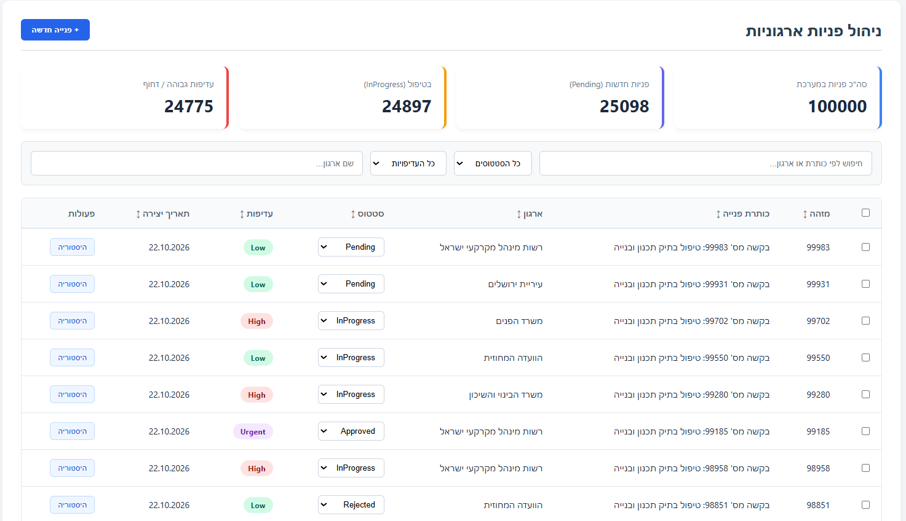
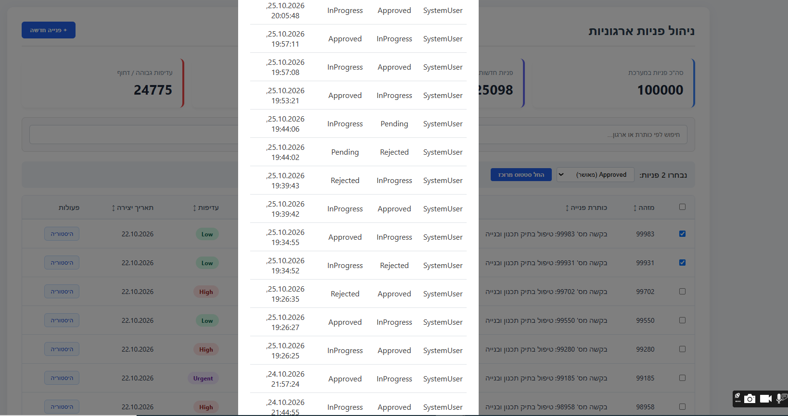

# 📘 מסמך תיעוד הפתרון - Request Management System (.NET 9 & React)

מסמך זה מפרט את התיעוד הטכני, הארכיטקטורה, הנחיות ההרצה וההחלטות ההנדסיות של מערכת ניהול הפניות.

> 💡 **הערת פיתוח וטכנולוגיה:** המערכת פותחה בצד הלקוח באמצעות **React (TypeScript)**, מתוך בחירה להציג ביצועים מקסימליים ושליטה מלאה בשפת האם שלי בפיתוח Frontend. המערכת מומשה בדיוק לפי כל דרישות ה-UI, ה-State Management והתנהגות ה-API המוגדרות במבדק (כגון Debouncing, ביטול בקשות, טיפול ב-Concurrency ומצבי Loading/Error). כמובן, אני שולטת ומכירה היטב גם את אקו-סיסטם ה-Angular ואשמח לפתח ולבצע משימות ברמה הגבוהה ביותר גם ב-Angular במידת הצורך.

## 🖼️ תצוגה מקדימה של המערכת (UI Preview)

להלן צילומי מסך מתוך ממשק ה-React של המערכת, הממחישים את תצוגת 100,000 הרשומות, האגרגציות, סינון הנתונים, פעולות ה-Bulk ומודל היסטוריית השינויים (Audit):

### 1. דשבורד ראשי וניהול פניות (כולל בחירת Bulk ואגרגציות)

### 2. צפייה בהיסטוריית שינויים (Audit History Modal)

---

## 🚀 1. הוראות הרצה והפעלת הפתרון

### דרישות מוקדמות (Prerequisites)
- **.NET 9 SDK** מותקן במחשב.
- **Node.js** (גרסה 18 ומעלה) ו-npm.
- **SQL Server / LocalDB** פעיל.

### שלבי הרצת השרת (Backend)
1. פתחי את ה-Terminal בתיקיית פרויקט השרת (`RequestManagementAPI`).
2. עדכני את מחרוזת ההתחברות בקובץ `appsettings.json` במידת הצורך (`ConnectionStrings:DefaultConnection`).
3. הריצי את פקודת ה-Migrations ליצירת מסד הנתונים והטבלאות ב-SQL Server:
   bash
   dotnet ef database update
(הערה: נתוני הבדיקה וה-Seeder יטענו אוטומטית למסד הנתונים בעליית השרת הראשונה הודות למנגנון האתחול).
4. הריצי את השרת באמצעות הפקודה:

Bash
dotnet run

Bash
dotnet run --project RequestManagementAPI.API/RequestManagementAPI.API.csproj
(או לחלופין, אם את נמצאת פיזית בתוך תיקיית ה-API עצמה, פשוט תריצי dotnet run).
ה-API יהיה זמין בכתובת: https://localhost:5001 (ניתן לצפות בתיעוד Swagger בכתובת https://localhost:5001/swagger).

שלבי הרצת ממשק המשתמש (Frontend)
ניווטי לתיקיית ה-React (client-app).

התקיני את חבילות התלות:

Bash
npm install
הריצי את אפליקציית ה-React:

Bash
npm start
פתחי את הדפדפן בכתובת: http://localhost:3000 (או הכתובת המוצגת ב-Terminal).

🛠️ 2. טכנולוגיות וגרסאות
Backend Framework: .NET 9 Web API

ORM & Database: Entity Framework Core 9, SQL Server / LocalDB

Caching: MemoryCache (IMemoryCache)

Frontend Framework: React 18+ (TypeScript), Axios / Fetch API, Hooks & State Management

Testing: xUnit, InMemory Database, WebApplicationFactory (Integration Tests)

API Documentation: Swagger / OpenAPI

🏗️ 3. תיאור מבנה הפתרון (Architecture & Layers)
המערכת ממומשת בארכיטקטורת שכבות נקיות (Clean / Layered Architecture) להבטחת הפרדת אחריות מלאה (Separation of Concerns):

API Layer (RequestManagementAPI.API): מכיל את ה-Controllers, טיפול גלובלי בשגיאות (Global Exception Handling) וניהול בקשות HTTP.

Business Logic Layer (RequestManagementAPI.BL): מכיל את הלוגיקה העסקית, ניהול תהליכי ה-Bulk, אכיפת חוקי ה-Validation ומנגנוני ה-Cache.

Data Access Layer (RequestManagementAPI.DAL): שכבת הגישה לנתונים מבוססת EF Core 9, כולל שאילתות אופטימליות (IQueryable) וניהול מודלים.

Testing Layer (RequestManagementAPI.Tests): בדיקות יחידה (Unit Tests) ואינטגרציה (Integration Tests) מקיפות.

🗄️ 4. בחירת בסיס הנתונים, אינדקסים ומניעת עומס זיכרון
בסיס הנתונים: נבחר SQL Server הודות לתמיכה מלאה בטרנזקציות אטומיות, נעילות אופטימיות ויכולת מוכחת לנהל ביצועים גבוהים מול כמות גדולה של רשומות (100,000+).

אינדקסים מותאמים (Indexes):

Composite Index על (Status, CreatedAt): לייעול סינונים ומיון כרונולוגי של פניות.

Index על Title & OrganizationName: לאופטימיזציה של חיפושים טקסטואליים.

Index על RowVersion / Id: לשליפה מהירה בזמן עדכונים ובדיקות Concurrency.

מניעת עומסי זיכרון (Memory Management & Pagination):

Paging בצד השרת: מניעת טעינת נתונים מסיבית לזיכרון השרת (OutOfMemoryException) על ידי אכיפת Paginated Queries (Skip ו-Take) ברמת מסד הנתונים.

שאילתות אופטימליות (IQueryable): הסינון והמיון מתבצעים ישירות ב-SQL Server לפני החזרת הנתונים לזיכרון השרת, תוך הימנעות מוחלטת משימוש ב-ToList() לפני ביצוע ה-Filtering.

🔄 5. הסבר על Concurrency ועל Bulk Update
ניהול עדכונים מתחרים (Optimistic Concurrency)
למניעת בעיית Lost Updates (מצב שבו שני משתמשים מעדכנים את אותה פנייה במקביל):

הוגדר שדה RowVersion מסוג byte[] (timestamp) בטבלת הפניות.

בעת עדכון סטטוס, השרת משווה את ה-RowVersion שהתקבל מהלקוח לערך הנוכחי במסד הנתונים.

במקרה של חוסר התאמה (עדכון מתנגש), השרת זורק חריגה ומחזיר קוד שגיאה 409 Conflict, המאפשר לממשק המשתמש להציג את הנתונים העדכניים למשתמש ולבצע רענון.

עדכון מרובה (Bulk Update)
תמיכה בעדכון עד 100 פניות בבקשה אחת.

מיושמת אסטרטגיית Partial Success: אם חלק מהפניות אינן קיימות או נכשלות עקב קונפליקט, הפעולה אינה מתבטלת כליל אלא מחזירה תשובה מפורטת עם פירוט הצלחות ורשימת שגיאות פרטנית עבור המזהים שנכשלו.

## 📈 6. בדיקות ביצועים וניתוח Execution Plans (דרישה 6)
על בסיס סימולציה מלאה של **100,000 רשומות** ב-SQL Server, נבחנו שתי פעולות ה-API המרכזיות במערכת כדי לוודא יעילות, מניעת עומסים ועמידה בסטנדרטים ארגוניים:

### א. שליפת רשימה עם סינון טקסטואלי ותאריכים (Pagination & Filtering)
* **אופן הבדיקה:** הרצת שאילתות סינון משולבות לפי `Status`, `OrganizationName`, חיפוש טקסטואלי ב-`Title` וטווח תאריכים, בשילוב `Skip` ו-`Take` בצד השרת.
* **Execution Plan & Indexing:** ניתוח ה-Execution Plan הראה מעבר חד מ-**Table Scan** מלא לשימוש ב-**Index Seek** יעיל הודות ל-**Composite Index** שהוגדר על `(Status, CreatedAt)` ולאינדקסים הנוספים. השאילתה שולפת אך ורק את עמודות ה-DTO הנדרשות דרך ה-`IQueryable` מבלי לטעון את כל הטבלה לזיכרון.
* **Bottleneck פוטנציאלי והפתרון:** חיפושי `LIKE '%term%'` על טקסט חופשי עלולים לגרום לזמני תגובה פחות אופטימליים בטבלאות ענק. הפתרון המיושם הוא תחום דפדוף הדוק (Pagination) ושמירת האינדקסים הקריטיים; בסביבת Production עמוסה במיוחד ניתן לשקול בעתיד הוספת Full-Text Search.

### ב. חישוב Aggregations ונתונים מסכמים
* **אופן הבדיקה:** שליפת נתונים מסכמים (כגון ספירת פניות לפי סטטוס).
* **Execution Plan & Indexing:** החישוב מבוצע ישירות מול מסד הנתונים באמצעות שאילתת `GroupBy` ממוקדת המנצלת את אינדקס ה-`Status`. בנוסף, התוצאה נשמרת ב-**Cache (`IMemoryCache`)** כדי למנוע קריאות חוזרות ומיותרות ל-DB תחת עומס קריאות גבוה, תוך שמירה על עדכניות בעזרת מנגנון Invalidation אקטיבי.

⚡ 7. הסבר על Cache ועל Invalidation
מנגנון ה-Cache: שימוש ב-IMemoryCache לשמירת נתונים מסכמים ונתוני אגרגציה (Aggregations / KPIs) כגון ספירת פניות לפי סטטוס.

מדיניות Invalidation: למניעת הצגת מידע מיושן (Stale Data), מופעל מנגנון Proactive Invalidation – בכל פעולת כתיבה, עדכון (כולל Bulk) או מחיקה, ערך ה-Cache מנוקה באופן יזום, ובקשת הקריאה הבאה מחשבת את הנתונים מחדש מול מסד הנתונים.

🔀 8. שתי החלטות טכנולוגיות משמעותיות וחלופות שנשקלו
בחירת Partial Success ב-Bulk לעומת Atomic Transaction (All-or-Nothing):

החלופה שנשקלה: ביצוע טרנזקציה אחת גדולה שמתבטלת לחלוטין (Rollback) אם פנייה אחת בתוך ה-Bulk נכשלת.

ההחלטה שנבחרה: Partial Success. במערכות ניהול פניות ארגוניות, עצירת תהליך של 99 עדכונים תקינים בגלל תקלה בודדת פוגעת בחוויית המשתמש. הוחלט לבצע עיבוד פרטני ולהחזיר דוח תוצאות מפורט ללקוח.

Optimistic Concurrency (RowVersion) לעומת Pessimistic Locking:

החלופה שנשקלה: נעילת רשומות ב-DB בזמן קריאה (Pessimistic Locking).

ההחלטה שנבחרה: Optimistic Concurrency. נעילת שורות פוגעת קשות בביצועים ובסקלביליות (Scalability) במערכות המשרתות משתמשים רבים. השימוש ב-RowVersion מאפשר קריאות חופשיות ומהירות ללא נעילות מיותרות.

⚠️ 9. מגבלה ידועה ושיפור עתידי מוצע
מגבלה ידועה (Known Limitation): השימוש ב-IMemoryCache מוגבל למופע שרת יחיד (In-Memory). בסביבת Production מבוזרת (Scale-Out מאחורי Load Balancer), ה-Cache לא יהיה מסונכרן בין השרתים השונים.

שיפור מוצע לעתיד (Future Improvement): מעבר לפתרון Distributed Cache (Redis) לשמירת האגרגציות, וצירוף מנגנון WebSockets / SignalR לעדכונים בזמן אמת (Real-time Push Notifications) ללקוח ה-React.

🤖 10. פירוט השימוש בכלי AI
כחלק מתהליך הפיתוח נעשה שימוש מושכל בכלי AI לייעול העבודה:

באילו חלקים נעשה שימוש:

יצירת שלד ראשוני לבדיקות האוטומטיות (xUnit & Integration Tests) וסינתוז סקריפט Seeding ל-100,000 רשומות.

ניסוח מבנה מסמכי התיעוד וטבלאות תוכנית העבודה (README.md).

מה נבדק ושונה ידנית:

תיקון לוגיקת Validation: התאמת ה-Assertions בטסטים להתנהגות החריגות בפועל (לדוגמה, שימוש ב-Record.ExceptionAsync לבדיקת סטטוס לא חוקי).

התאמת בדיקות אינטגרציה: התאמת ציפיות ה-API לקבלת תשובות 200 OK תקינות בשליפת Audit לרשומות ריקות.

בדיקת ביצועים: וידוא ידני של תוכניות הריצה (Execution Plans) ב-SQL Server למניעת Table Scans מיותרים בשאילתות הסינון והמיון.